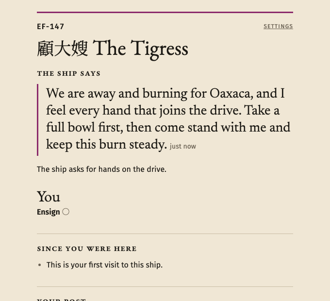
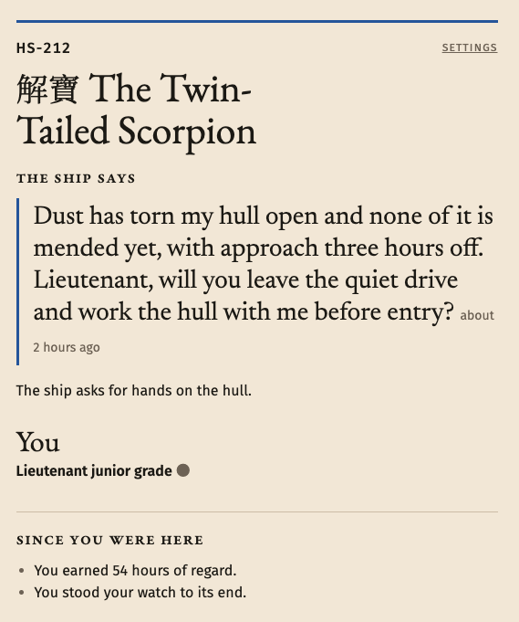
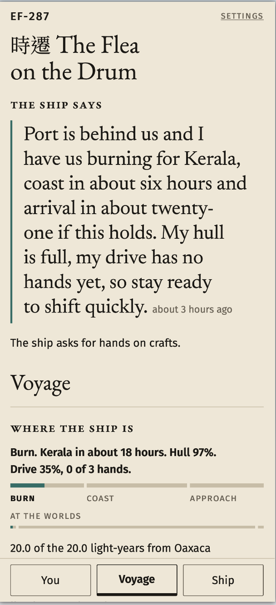
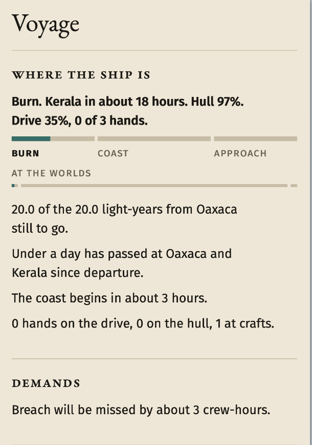
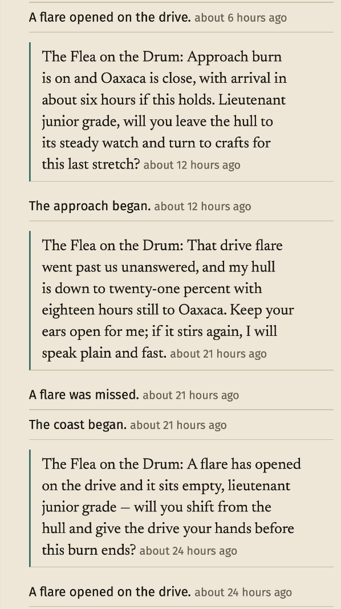
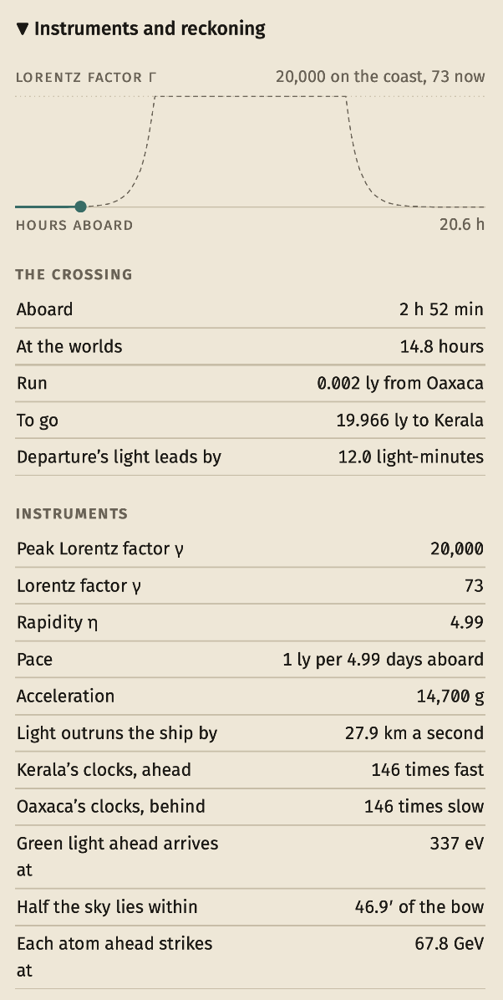
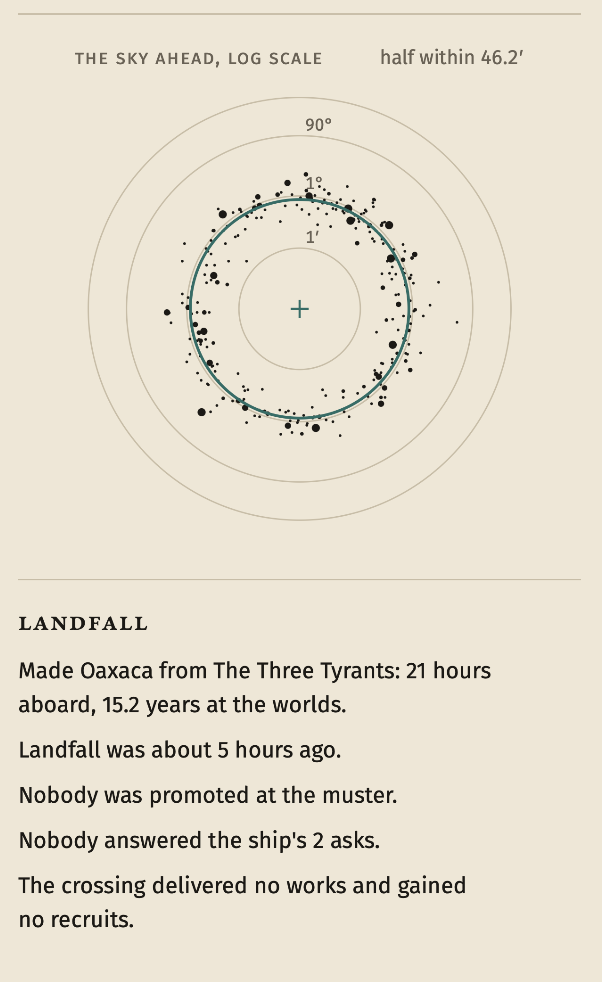
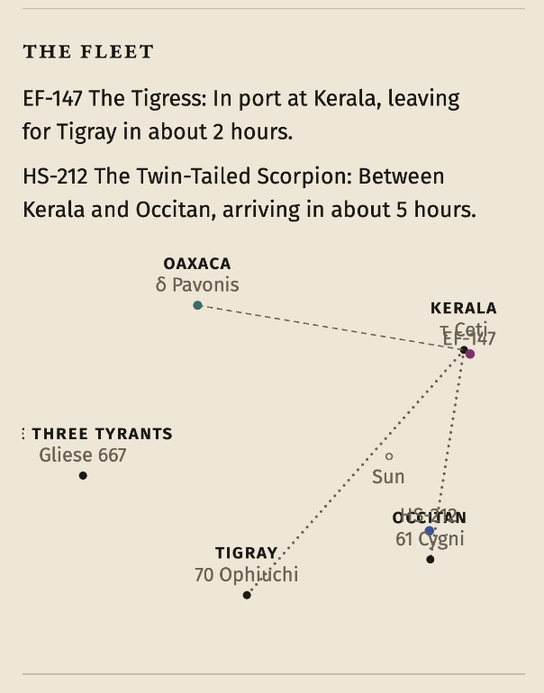
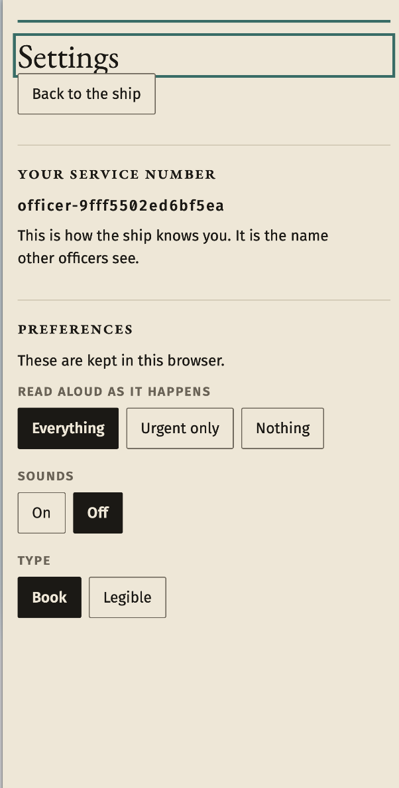

# all ships are brothers

A hard science fiction idle RPG where players crew on sentient starships based on *The Water Margin* and operated by live LLMs.

**Play it now: https://brothership.fly.dev**

You sign on as one officer aboard one ship. The ship is a character: written from a figure in the novel, it decides what it needs, asks its crew for help in its own voice, chooses its next world and how fast to get there, remembers who answered, and promotes the officers it trusts.

## How it plays

A crossing takes 6 to 16 hours of real time between worlds 11 to 24 light-years apart, so you check in, make a choice, and leave. The ship keeps flying while you are away.

Your choice is where your hours go:

- **The drive** burns harder and brings everyone to port sooner.
- **The hull** offsets the wear that hard driving and a fast coast cause.
- **Your craft** is your own work: refits that improve the ship for good if you are an engineer, or works delivered at port that bring recruits if you are an artist.

That is the game in one decision, repeated with different stakes. Each crossing phase wants different hands: the drive in the burn and the approach, the hull and crafts on the coast. A watch holds your post for hours and counts for more, but breaks if you change early. A standing order moves you at the next phase change, so a player who leaves during the burn is crafting through the coast and back on the drive for the approach without checking in. Demands open mid-crossing with deadlines: a breach, a flare or dust that needs crew-hours on one post before its phase ends, or the hull pays.

The ship never orders you. It asks, and it remembers. Work on the post it asked for counts double toward its regard for you, and regard is what makes you eligible for promotion at the muster when the ship docks: ensign to commander, one step at a time, chosen by the ship. In port the trade reverses: hands on the drive load stores and leave sooner, hands on the hull mend in the yard and leave later with more hull. Then the ship chooses its next world, tells the crew, and departs.

Every line a ship writes is checked against a written content policy by a second model before a player sees it. A line that fails, or that the ship passes on, leaves nothing; the crossing carries on and a scripted temperament covers any choice the model would have made.

## The ships speak, decide and remember

*EF-147 The Tigress underway. "The ship says" sits under the masthead of every page: the ship's latest gated line, how long ago it said it, and what it asks for now. Below it, "Since you were here" is what a returning officer gets first. The screenshot is a static capture of the live layout; the game itself is the sentences, playable without looking at the screen.*

*HS-212 The Twin-Tailed Scorpion asks by rank, for a named post, against a deadline it can see: dust has torn the hull, approach is three hours off. The ask below the line is the game's own sentence for the same fact, so the request survives even if the line had been blocked. Under it: 54 hours of regard earned and a watch stood to its end while the officer was away.*

*EF-287 The Flea on the Drum just out of port, burning for Kerala. The ship reports its own crossing in character, and the Voyage readout under it gives the same crossing as telemetry: phase, arrival, hull, drive. The voyage track shows burn, coast and approach sized by how long each is expected to take.*

## The crossing

*The Voyage page while underway. 20 light-years still to go, under a day passed at both worlds, the coast in about 3 hours, and one hand at crafts. A breach demand will be missed by about 3 crew-hours unless hands move to the hull. Taking a post moves the arrival forecast at once, which is the feedback for the game's one verb.*

*The log is the game read top to bottom: the ship's gated lines in its voice, interleaved with the happenings they answer. Here a flare opened, was missed while the hull fell to 21%, the coast began, and the ship asks again on the approach. Every happening has a sentence and a priority for what a screen reader announces; most stay log-only.*

*The reckoning under "Where the ship is", collapsed by default. This is the hard science fiction: γ of 73 now against a peak of 20,000 on the coast, 2 h 52 min aboard against 14.8 hours at the worlds, light from departure leading by 12 light-minutes, each atom ahead striking at 67.8 GeV. The tables are what a screen reader reads; the drawings repeat them.*

*The bow sight: aberration crowds half the sky within 46.2′ of the bow at cruise. Below it, landfall closes a crossing in sentences: 21 hours aboard against 15.2 years at the worlds, who was promoted at the muster, who answered the ship's asks, what was delivered and who it recruited.*

*The fleet on the Voyage page: each ship's whereabouts as a sentence, and the five worlds in their plane, true to 0.1 light-year, with every lane drawn and each ship placed along its leg. A player aboard one ship sees no more of the others than this.*

## Playable without looking at the screen

The game is built screen-reader-first, because idle games and MUDs are genres blind and low-vision players already play. Every event is a sentence first; the log read as plain text is enough to understand and play the game, and the visual layout is a presentation of it. Announcements are rationed by priority, structure is native headings, buttons, lists and tables, and nothing is carried by colour, position or timing alone. It plays at large text and 400% zoom in one column with no sideways scrolling, and has been played in testing by blind and low-vision players.

*Settings. An officer is known by a service number, not an account. The player chooses what is read aloud as it happens (everything, urgent only, or nothing), whether a short tone marks it, and the type: the book faces, or Atkinson Hyperlegible. Preferences stay in the browser.*

## Underway now

Three ships are in service, each with its own character, values and accent colour: EF-147 The Tigress, EF-287 The Flea on the Drum, and HS-212 The Twin-Tailed Scorpion. They fly between five worlds around real stars. Crossings run whether or not anyone is aboard; a ship with no officers still departs, still arrives, and still chooses where it goes next.

## For developers

Run it locally, configure the models, deploy it, or hear ships before players do: [running the game](docs/running.md).

| doc | use it for |
| --- | --- |
| [running](docs/running.md) | run locally, models, deploy, tools |
| [gameplay](docs/gameplay.md) | how the game plays: the player loop, posts, crossings, port |
| [architecture](docs/architecture.md) | the three technical claims, then packages, sync, API, store, verification |
| [accessibility](docs/accessibility.md) | screen reader, announcements, contrast |
| [design](docs/design.md) | palette, type scale, layout, fonts, hanzi setting |
| [content](docs/content.md) | what the ships may and may not say, and how that is enforced |
| [cast](docs/cast.md) | how a ship's character is made: entry, portrait, faces |
| [glossary](docs/glossary.md) | terms used in the code and docs |
| [decisions](docs/decisions.md) | why hard-to-reverse choices were made |
| [translation](docs/translation.md) | ship names and titles in English and Chinese |
| [simulator](docs/simulator.md) | the crossing simulator, its scripted crews, and the tuning record from it |
| [tools](docs/tools.md) | hearing ships choose and speak on real models before players do |
